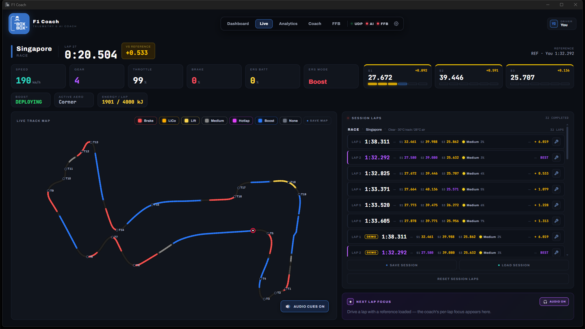
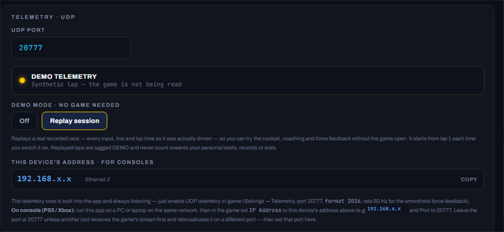
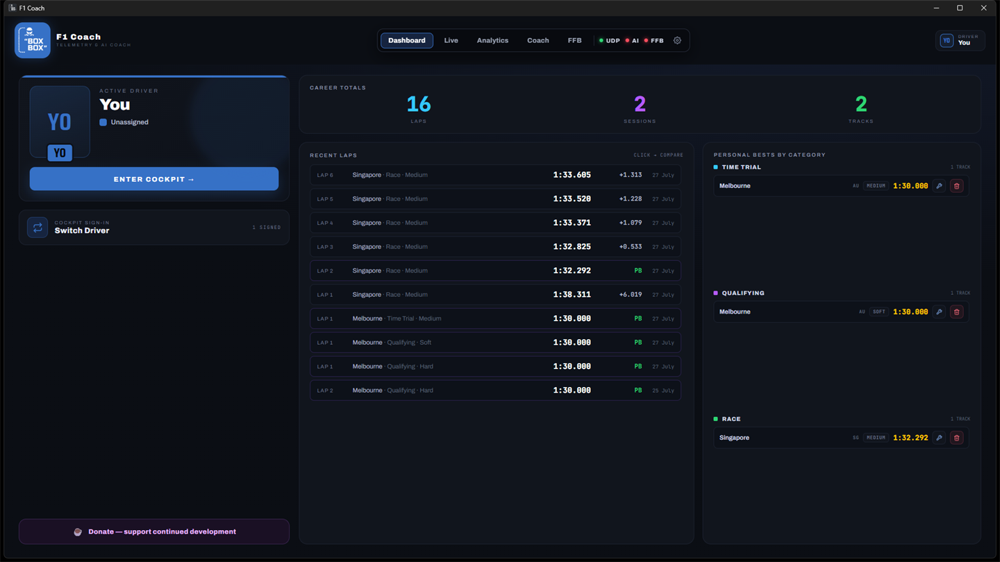
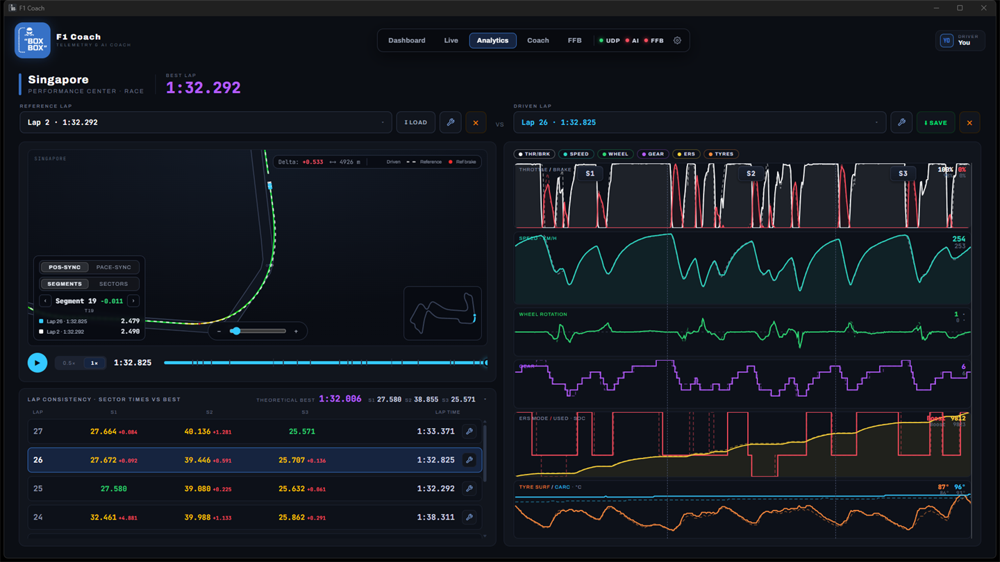
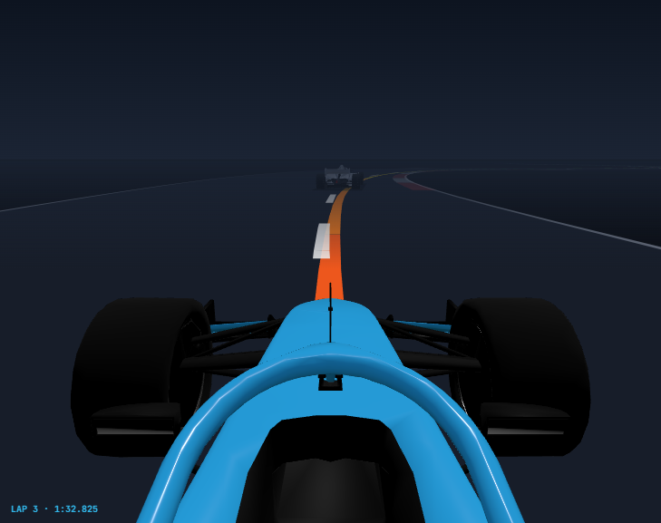
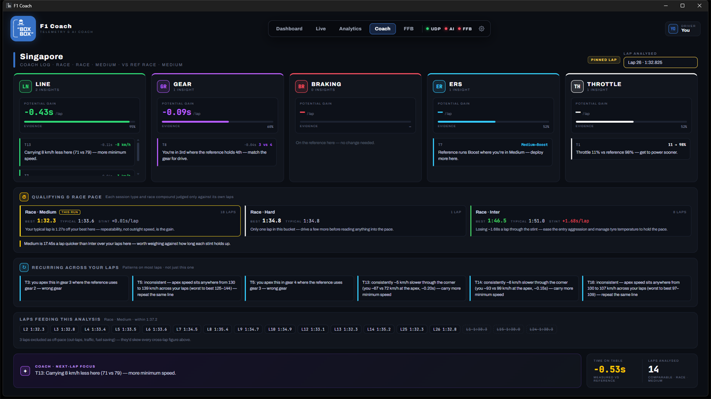
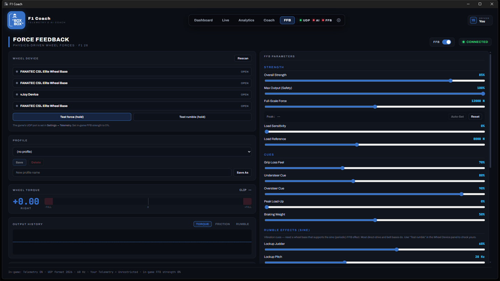

# F1 Coach

[](https://discord.gg/2bZGXGBZj9)

**An AI race engineer for EA SPORTS F1™ 25/26.** F1 Coach reads the game's live UDP
telemetry, compares your driving against reference traces, drives your force-feedback
wheel, and coaches you over "team radio" — real-time braking/ERS calls in the corner, and
an LLM race engineer that debriefs you between laps.

> Windows desktop app built with **Tauri 2** (Rust shell) + **React 18 / Vite** frontend.
> Telemetry parsing and force feedback run in-process in the Rust core. Small installer,
> low RAM — designed to run alongside the game.



<sub>Screenshots are taken in demo mode — the app replaying a real recorded Singapore race —
on the default livery. Team skins restyle the whole app.</sub>

---

## What's new in 4.2.0

> Found a problem? Report it on the [Discord](https://discord.gg/2bZGXGBZj9) or the
> [issue tracker](https://github.com/therealbeno82/BoxBoxF1Coach/issues). For force feedback,
> attach an **Export trace** file (see [Tuning the force feedback](#tuning-the-force-feedback)).

**Force feedback, rebuilt for direct drive.**
- **The wheel is updated on its own clock**, 200 times a second by default. In 4.1 it was
  updated once per game packet, a staircase of 60 steps a second that a direct-drive base
  feels as grain or "cogging".
- **A smooth curve between the game's frames** (*Frame Interpolation → Cubic*), with the
  old behaviour one click away for comparison.
- **New settings:** Slew Limit, Damper, Reconstruction Delay.
- **New diagnostics:** the game's real frame rate, update timing, and an exportable output
  trace.

See [Tuning the force feedback](#tuning-the-force-feedback).

**FFB safety fixes:**
- The force could stay on, with a green light, after the game took the wheel.
- Releasing *Test force* mid-drive could snap the wheel.
- *Test force* ignored your Max Output cap.
- An imported or hand-edited profile could carry values that reverse the steering force.
  Every setting is now clamped to its slider's range.

**Coaching:**
- **The coach works from your first comparable lap.** With no reference picked, your own
  fastest comparable lap at that track is used automatically (shown as *Auto · your best*),
  so corner calls and the debrief no longer wait for you to load one.
- **A live gap to the reference** while you drive.
- **Where the time went:** a Δt trace in Analytics, corners ranked by time lost with jump
  buttons, and *Show on lap* from any Coach insight.

**Laps:**
- **Driver aids, flashbacks and penalties are recorded** on every lap, read from the game.
- A lap with a flashback can't be published. Assisted laps show an **Aids** tag on the
  leaderboards.

**Fixes:**
- **2026 sector boundaries were wrong.** Every 2026 session fell back to even thirds for
  sectors and mini-sectors. They are now read from the game.
- **Live sector deltas compared against the right track.** They used the best sectors of
  whichever circuit held your fastest lap overall.
- **Deleting a lap in Analytics asks first.**
- **Leaderboards switched off now means no requests at all,** publishing included.
- **The UDP pill turns green when the game was already running** before the app opened.
  Settings now says when the telemetry port is taken or the game's UDP Format is wrong.
- **A crashed voice engine no longer silences the coach** for the rest of the session.
- **AI coach errors say what went wrong** (no credits, wrong model, rate limit) instead of
  "check your API key".
- **Smaller fixes:**
  - Playback in Analytics no longer redraws the whole app every frame.
  - Choosing or opening a wheel no longer freezes the window.
  - The installer is about 4 MB smaller.

---

## What it does

- **Live telemetry dashboard** — speed, throttle/brake, gear, ERS mode, tyre & brake temps,
  DRS, fuel, and per-sector / mini-sector timing, streamed live from the game at up to
  30 Hz.
- **Reference-trace comparison** — pick a reference lap (a hot lap you drove, a `.json`
  trace file, or someone else's lap off a leaderboard) and see where you're losing time,
  corner by corner, sector by sector. Pick nothing and your own fastest comparable lap is
  used, with a running gap to it while you drive.
- **Driving Lines — watch the two laps drive** against each other from four cameras: a
  top-down map, a free-orbit 3D view, an onboard T-Cam from either seat, and a stacked
  Compare showing both seats at once. Both cars are real 3D models on real circuit
  geometry, and you can play, scrub and step segment by segment.
- **Online leaderboards** — publish a lap to a public board for the circuit, see where it
  puts you, and download a faster driver's lap to coach against. Opt-in, no sign-up, and
  every submission is validated server-side against its own telemetry.
- **Two-layer coaching** (see [Architecture](#architecture)):
  - A **real-time rule engine** makes in-corner calls (brake point, lift-and-coast, ERS
    deployment) the instant they're needed.
  - An **LLM race engineer** acts as a between-lap analyst — a grounded debrief of the lap
    you just completed, plus a next-lap focus.
- **Force feedback** — a Rust FFB engine drives your wheel from the raw telemetry via SDL2
  at up to 360 Hz, rebuilding a smooth force from the game's 60 Hz frames, with its own
  live monitor, a full set of tunable parameters and an exportable output trace.
- **Voice out** — local **Kokoro** text-to-speech (ONNX, self-hosted, runs offline) so the
  calls come at you as radio, hands on the wheel. There is no voice input.
- **Speech arbiter** so the engine and the AI never talk over each other — urgent real-time
  calls preempt; stale AI tips are dropped.
- **Mini-sector derivation** — the F1 UDP stream only broadcasts 3 real sectors, so the app
  derives 18 mini-sectors locally from the real sector boundaries and colours them with the
  game's own faster/slower rule.

---

## Setup guide

### 1. Install

Grab the latest `F1.Coach_<version>_x64-setup.exe` from the
[Releases](https://github.com/therealbeno82/BoxBoxF1Coach/releases) page and run it. It's a
normal Windows installer — no runtime to install separately (WebView2 ships with current
Windows). To build it yourself instead, see
[Building from source](#getting-started-development).

Betas are on the same page, marked **Pre-release**. They install over a stable version and
your laps, settings and driver profiles carry over. If you want a safety copy first, use
**⚙ Settings → Driver Profile → Export Profile**. The app's update banner only announces
stable releases, so a beta never appears there.

### 2. Turn on UDP telemetry in the game

In **F1 25/26**: *Settings → Telemetry Settings*

| Setting          | Value                                              |
|------------------|----------------------------------------------------|
| UDP Telemetry    | **On**                                             |
| UDP Format       | **2026** (the app parses the 2026 packet format only) |
| IP Address       | `127.0.0.1` on PC — or your PC's LAN IP on console (see below) |
| Port             | `20777`                                            |
| Send Rate        | **60 Hz** (most FFB data per second)               |

The app is always listening — there's no "connect" button. The **UDP** pill in the header
goes green when packets arrive. If it doesn't, **⚙ Settings → Telemetry · UDP** says
why when it can tell: another telemetry tool already holds the port, or the game is
sending a UDP Format other than 2026.

### 3. Sign a driver

Open **⚙ Settings → Driver**. Add a name, number, team and livery colour. Everything the
app records — laps, personal bests, preferences, the coach's history — is stored per
driver, and the team livery reskins the whole UI.

### 4. Connect the coach (optional)

In **⚙ Settings → AI Coach**, paste an **OpenRouter API key** and pick a model (default
`anthropic/claude-3.5-haiku`; *Load models* lists everything OpenRouter offers). Without a
key the real-time rule engine still runs in full — you just lose the between-lap debrief.

> The key is stored in plain text in the app's local storage. It never leaves your machine
> except in requests to OpenRouter.

### 5. Set up your wheel (optional)

**Set the game's own force feedback strength to 0%** — the app replaces it, and the two
can't share a wheel. Then open the **FFB** tab, pick your wheel under *Wheel Device*, and
choose a profile. The live monitor shows wheel torque, clipping and the grip gauges so you
can tune with feedback; [Tuning the force feedback](#tuning-the-force-feedback) walks
through the settings.

### 6. Try it without the game

**⚙ Settings → Demo Mode → Replay session** replays a real recorded race — a 25-lap
Singapore run that goes from mediums to intermediates when the rain arrives — through the
whole pipeline: cockpit, coaching, voice and FFB, with no game running. Every input, racing
line and lap time is the one that was actually driven, so the traces, the track map and the
coach's debrief all show real driving. It restarts from lap 1 each time you switch it on.
Replayed laps are tagged **DEMO** in the lap log and never count: they can't take a personal
best, set a sector record, or appear in your stats, and the coach never measures a lap you
drove against one of them.

---

## Playing on console (PS5 / Xbox)

Console telemetry works. The game will happily broadcast to another device on your network,
and the app listens on all interfaces, so:

1. Run F1 Coach on a **PC or laptop on the same network** as the console.
2. In **⚙ Settings → Telemetry · UDP**, find *This Device's Address* — click an address to
   copy it.
3. In the game's telemetry settings on the console, set **IP Address** to that address and
   **Port** to `20777` (format 2026, 60 Hz as above).



**The known limitation:** the coach's audio comes out of the PC running the app, not the
console. So the radio calls play through whatever speakers/headset that PC is using, while
you're wearing a headset plugged into the console — which in practice means you either
don't hear the coach, or you have to run one earbud from each device.

There's no clean fix in the app today. Workarounds that people use, roughly in order of how
well they work:

- Run the PC's audio into a **headset you can hear alongside the console** (a second earbud,
  or an open-back headset with the console on speakers).
- Feed the PC's output into a **mixer or an audio interface** together with the console's,
  and drive one headset from the mix.
- Use a **Bluetooth/USB headset paired to the PC** and take game audio from the TV.

Solving this properly — streaming the coach's audio to the console side, or to a phone/app
you can pair with your headset — is an open problem and a wanted feature. If you have ideas
or a working rig, open an issue.

---

## Using the app

The header switcher has six screens, with **UDP / AI / FFB** status pills and the driver
chip alongside.

### Dashboard
Your session at a glance: personal bests per circuit and session type, lap counts, recent
form and trends across everything the active driver has ever driven.



### Live
The cockpit view while you're on track — speed, gear, revs, ERS, tyre and brake temps, fuel,
DRS, delta and the 18 mini-sectors colouring live as you cross them, plus the track map with
numbered corners. This is where the rule engine's in-corner calls fire. The map colours each
zone by the call it carries — brake, lift-and-coast, lift, boost — and the sector strip
shows where the lap is going against the reference. **Live Δ vs Ref** is a running gap to
the reference at the point of the lap you're on: minus is ahead, plus is behind. It goes
quiet when the reference isn't comparable with what you're driving. (Screenshot at the top
of this page.)

### Analytics
Post-session analysis in one view. Pick a **Reference** and a **Driven Lap** from the two
selectors and the traces overlay — speed, throttle, brake, gear, steering — with hover
readouts and a per-corner time-loss breakdown.



- Any lap you've driven can be the reference; **⬆ Load** imports `.json` trace files
  (multiple at once) and **⬇ Save** exports the lap on screen so you can share it or keep it
  as a benchmark.
- **Auto · your best** is the default reference. It's your fastest lap at this circuit
  that's comparable with the one you're looking at, so the coach works without you loading
  anything. Pick a lap to override it, or **None** for no reference at all.
- The reference only counts if it's **comparable** — same circuit, same wet/dry, same
  race-vs-push intent, same compound. If it isn't, the app tells you and withholds both the
  insights *and* the corner calls, since both are derived from that reference.
- **Δt** is the top trace in the stack: the running time gap to the reference across the
  lap. Where it climbs you're losing time; where it falls you're gaining it.
- **Most time lost**, under the Driving Lines playback, names the three stretches of the lap
  that gave away the most to the reference. Click one to jump straight there.
- Deleting a lap with the 🗑 asks first. The ✕ beside a *loaded* reference only unloads it.

#### Driving Lines

The left half of Analytics replays the two laps against each other on the real circuit.
Press play and both cars drive the lap; scrub the timeline, or step corner by corner with
the segment card. The timeline also takes the arrow keys, and the mouse wheel zooms the Map
as well as the 3D view. One scene, four cameras:

| View | What it's for |
|------|---------------|
| **Map** | Top-down. The whole shape of both lines at once — where you ran wide, where you turned in early. |
| **3D** | Free-orbit camera you drag. For seeing a corner from an angle that shows the entry-to-apex sequence, which the plan view flattens. |
| **T-Cam** | Onboard, from one seat. The other car is a real 3D model up the road, so the gap is something you can see rather than read. |
| **Compare** | Both seats stacked, at the same track distance — the same corner from each driver's eyes. |

Two sync modes decide where the *other* car goes:

- **Pos-sync** — both cars at the same track distance, so the only difference on screen is
  the line each driver took. This is the one for studying racing lines.
- **Pace-sync** — the other car is placed where it actually was at the same elapsed time,
  so the faster lap pulls away and the time gap builds in front of you.

The road is built from the committed circuit geometry with kerbs, painted edges, corner
markers and the reference driver's brake points drawn as gates across the track, and it
climbs and falls with the real elevation of the lap you recorded.



### Leaderboard

Public boards for every circuit, split by Qualifying and Time Trial — 50 boards. Each row
is a driver's best lap with the gap to the leader and the tyre they ran.

- **Publishing is always yours to make.** Set a personal best on an eligible board and a
  prompt offers to publish that lap; nothing goes up without you pressing Publish.
- **Download any lap as your reference** and the whole coach — delta trace, corner calls,
  between-lap debrief — measures you against it. Downloads are stored locally, so they
  survive a restart and keep working offline.
- **No sign-up**, one lap per driver per board, and every submission is re-validated
  server-side from its own telemetry before it lands.
- **Flashback laps can't be published.** The game reports every flashback, and the lap
  records it.
- **Aids are disclosed, not refused.** A lap driven with traction control, ABS, assisted
  braking or steering, an automatic gearbox, the racing line or equal car performance shows
  an **Aids** tag; hover over it to see which. Only laps recorded with 4.2 or later carry
  this.
- Opt-in: turned off in Settings, the app makes no leaderboard request at all — publishing
  included.

### Coach
The debrief. A structured read of one completed lap per telemetry channel, a
qualifying/race-pace assessment, and a next-lap focus. It follows your newest lap by
default; the **Lap analysed** selector pins it to any lap of the session. The deterministic
analysis is free and instant; the LLM debrief costs an API call and sits behind a button.
**Show on lap** on any insight opens Analytics with the playback at that spot. If the AI
debrief fails, the panel says why: no credits, an unknown model, a rate limit or a bad key.



### FFB
Wheel setup and live monitoring — device and profile pickers, wheel torque and clip meters,
an output scope, grip gauges, and the full parameter set (strength, output rate, full-scale
force, load sensitivity and the rest) with hover hints explaining each one.

The wheel is driven by a fixed-rate output loop, **not** by the game's UDP packets. The
engine rebuilds a smooth force from the game's ~60 Hz physics frames and updates the wheel
at the chosen **Update Rate** (200–360 Hz for direct-drive bases), so force changes
continuously instead of stepping once per packet — the usual cause of a notchy, cogging
feel.



#### Tuning the force feedback

**Before you start**

- Set the game's own force feedback strength to **0%**. Windows gives a wheel's force
  feedback to one program at a time, so the app replaces the game's FFB instead of adding
  to it.
- Set the game's telemetry **Send Rate to 60 Hz**. That rate is the raw material for
  everything below.
- Pick your wheel under **Wheel Device**. Hold **Test force** to confirm it responds. Hold
  **Test rumble** to confirm the vibration channel works.
- If the device shows **RECONNECTING**, something else took the wheel (usually the game
  starting up). The app reconnects it by itself when telemetry starts flowing.

**Coming from 4.1?** Your saved settings carry over. New settings start at their defaults.

- **Update Rate:** a saved rate below 200 Hz is raised to 200 once (4.1's default was 90).
  Saved **profiles** keep the rate they were saved with, so check Update Rate after loading
  an old profile.
- **Frame Interpolation:** starts on **Cubic**.

**The new settings**

| Setting (group) | Default | What it does | When to change it |
|---|---|---|---|
| **Frame Interpolation** (Reconstruction) | Cubic | How the force is drawn between the game's frames. *Linear* joins them with straight lines, which leaves a small kink in the force at every frame, 60 times a second. *Cubic* draws a smooth curve through the last four frames that still passes exactly through each one and never overshoots. | Leave it on Cubic. Switching to Linear for a few laps is the quickest way to feel what Cubic does. |
| **Reconstruction Delay** (Reconstruction) | 0.5 frame (≈ 8 ms) | How far behind the newest frame the wheel is drawn. At 0.5 the last half-frame is predicted; nearer 1.0 the curve always has a real frame on both sides. | Raise towards 0.75–1.0 if there's still grain after the rest of this guide. Each step adds delay. The **Est. chain latency** readout below it shows the total. |
| **Update Rate** (Output) | 200 Hz | How often the wheel receives a new force, independent of the game's 60 Hz. | 200–360 Hz for direct drive. Lower it if a belt or gear wheel drops force at high rates. |
| **Slew Limit** (Output) | 0 (off) | Caps how fast the force can change, in full-scale per second. It removes fast, small grain but leaves steady force and weight alone. | Try it **before** Smoothing. Start around **5/s** and raise it until the grain calms. Lower it if real kerb strikes and snaps start to feel slow. |
| **Smoothing** (Output) | 15% | A low-pass filter on the force. It is now two gentle stages instead of one, so it removes more grain for the same delay and never overshoots. | Lower it for a crisper wheel, raise it to calm oscillation. It costs up to ~40 ms of delay at maximum, and it softens detail along with grain. |
| **Damper** (Output) | 100% | The friction effect your wheel base adds as it turns. Some direct-drive bases render it coarsely at low speed, which feels like notches around centre. | Set it to **0** to rule it out if the centre feels notchy or grainy. |

**A tuning order for a grainy or notchy wheel.** Change one thing at a time and drive the
same corners after each change.

1. Open **TELEMETRY** on the FFB tab and check two readings while driving:
   - **Physics** should read about **60 Hz**. Lower means the game's Send Rate is lower, or
     packets are being lost on the network.
   - **Knot Clock** should read **GAME**. *ARRIVAL* is normal in demo mode and for a moment
     after a session change; if it stays on ARRIVAL while you drive, report it.
2. **Frame Interpolation → Cubic.**
3. **Damper → 0.** If that fixes it, the grain was your base's damper. Leave it low.
4. **Slew Limit → 5/s**, then adjust.
5. Only then raise **Smoothing**.
6. Still grainy? Raise **Reconstruction Delay** towards 1.0.

**Simucube 2 owners:**
- Keep the base's Reconstruction Filter low (0–1); the app is already doing that job.
- In the base's own software, mute *Game Effects → Sine Wave* and *Damper* to hear only
  what the app sends.
- Use the base's Notch Filter for a single offending frequency.

**Diagnostics on the FFB tab**

- **Tick Late** is how late the average wheel update is, in microseconds. It turns yellow
  if any update in the last window was more than 1.5 ms late, which usually means a busy
  PC.
- **CLIP** on Wheel Torque is how often the force is hitting 100%. If it's high, use
  **Auto-Set** beside **Full-Scale Force** after 2–3 clean laps.
- **The status pill** says when force is deliberately off: *PAUSED · FFB RELEASED*,
  *AI DRIVING · FFB RELEASED* (the qualifying run-up) and *AI START · FFB HELD* (the Time
  Trial start hold).
- **Export trace** saves the last ~45 seconds of output while a wheel is open. If the wheel
  feels wrong, drive the corner that shows it, press Export trace straight away, and attach
  the file to your report with your wheel model and settings.
  `node scripts/analyze-ffb-trace.mjs <trace.json>` measures the fine grain from it (two
  files compare an A/B).

Profiles you import, or edit by hand, are clamped to each slider's range when loaded. A
value outside it can't reverse the steering force or remove the Max Output cap.

### ⚙ Settings
UDP port and device addresses, demo mode, units (speed, tyre temps), the coach's API key and
model, voice engine and voice, team skins, the driver roster, and profile backup/import.
When no telemetry is arriving, the UDP panel says why if it can tell (port taken, or the
wrong UDP Format). Profile backups now include the leaderboard laps you've downloaded as
references.

---

## Architecture

```
 ┌────────────────────┐   UDP :20777    ┌─────────────────────┐  Tauri events  ┌──────────────────────┐
 │  F1 25/26 (game)   │ ──────────────▶ │  Rust telemetry core│ ─────────────▶ │  React UI (WebView)  │
 │  UDP telemetry     │   format 2026   │  (in-process)       │  ~30 Hz, only  │  in the Tauri shell  │
 └────────────────────┘                 └──────────┬──────────┘   on change    └──────────┬───────────┘
                                                   │ lock-free snapshot                   │
                                                   ▼ (full rate)              ┌───────────┴────────────────────┐
                                        ┌─────────────────────┐               │  Coaching                      │
                                        │  FFB engine (Rust)  │               │  • Rule engine (real-time)     │
                                        │  → wheel via SDL2   │               │  • LLM (between-lap debrief)   │
                                        └─────────────────────┘               │  • Kokoro TTS (voice out)      │
                                                                              └────────────────────────────────┘
```

**Why an in-process core?** The webview can't read raw UDP, so the Rust shell owns a single
UDP listener that parses the game's packets and publishes a lock-free snapshot. Two consumers
read it: the force-feedback engine at full rate (UI cadence never adds FFB latency), and an
emitter thread that forwards changes to the UI as Tauri events at ~30 Hz. No sidecar process,
no WebSocket — it starts and stops with the app.

**Why two coaching layers?** An LLM is too slow to make on-the-mark corner calls, so all
real-time calls live in a deterministic rule engine that always runs (and is what you get
when no AI is connected). The LLM only speaks in quiet windows — at the start/finish line,
with a lap debrief. A priority-based speech arbiter (`urgent > normal > low`) keeps the two
from overlapping.

### LLM provider
The coach speaks through **OpenRouter** (cloud, low-latency models suit short radio
calls — default `anthropic/claude-3.5-haiku`, switchable to any OpenRouter model from
Settings). The prompt layer includes genuine guardrails — grounding (the model may only
cite numbers present in the lap evidence), location language (corners, not metres),
scope/anti-jailbreak, and untrusted-data wrapping.

---

## Tech stack

| Layer          | Tech                                                                 |
|----------------|----------------------------------------------------------------------|
| Native shell   | Tauri 2 (Rust), `tauri-plugin-opener`, `tauri-plugin-log`            |
| Frontend       | React 18, Vite 6                                                     |
| Telemetry      | In-process Rust UDP parser (2026 packet format), lock-free `arc-swap` snapshot |
| Force feedback | Rust FFB engine → wheel via SDL2 haptics (statically linked)         |
| Speech         | `kokoro-js` (TTS) on ONNX runtime, self-hosted wasm                  |
| LLM            | OpenRouter                                                           |
| 3D views       | three.js (lazy-loaded — never in the startup chunk) + a hand-written pinhole camera for the T-Cam |
| Leaderboards   | Supabase (Postgres + storage + anonymous auth + Edge Functions)      |
| Packaging      | Tauri NSIS installer                                                 |

---

## Project layout

```
src/                     React app
  BoxBoxApp.jsx          Root: telemetry/lap/coaching state, lap recorder, speech pipeline
  components/screens/    Dashboard, Live, Analytics, Coach Log, Leaderboard, FFB, Settings
  components/            Shell (nav chrome), telemetry studio, driving lines, T-cam + orbit views, modals
  lib/coach/             Prompts, schema, guardrails, lap analysis, reference matching, provider
  lib/leaderboard/       Board keys, entry mapping, anti-tamper validation, thresholds, config
  lib/racingLine.js      Curve addressing: Catmull-Rom, arc-length-even car placement, heading
  lib/tcam*.js           Onboard view: pinhole camera (no imports), 2D scene painter, WebGL car layer
  lib/orbitScene.js      Free-camera 3D scene for the Driving Lines 3D view
  lib/                   Track data & geometry, corner anchors, tyres, formatting, Kokoro TTS, UI tokens/skins
  hooks/                 useTelemetry, useTauriEvents, useFfbEngine, useLlmHealth, useTrackCorners, useUpdateCheck
supabase/functions/      Edge Functions — the only writer to the leaderboard tables
scripts/copy-ort.mjs     Copies ONNX runtime wasm into /public/ort (CSP: served same-origin, not via CDN)
src-tauri/src/telemetry/ Rust core: UDP listener + 2026-format packet parsing, shared snapshot
src-tauri/src/ffb/       Rust FFB engine: reads the snapshot, drives the wheel via SDL2
src-tauri/src/lib.rs     Tauri commands + the ~30 Hz change-only event emitter; window + CSP config
public/ort/              Self-hosted ONNX runtime wasm
public/tracks/           Committed circuit geometry (all 25 circuits)
```

---

## Prerequisites (building from source)

- **Windows 10/11**.
- **Node.js 22+** and npm.
- **Rust** (stable, MSVC toolchain) + **Visual Studio Build Tools** (Desktop C++) and
  **CMake** — SDL2 is built from source and statically linked, so the first compile is slow.
- **WebView2** runtime (preinstalled on current Windows).

---

## Getting started (development)

```bash
# 1. Install dependencies (also copies the ONNX runtime into /public/ort)
npm install
```

```bash
# 2. Fetch the local Kokoro TTS weights (~97 MB, one-time — not in git)
node scripts/fetch-kokoro-model.mjs
```

```bash
# 3. Run the full native app (the Rust core owns the UDP listener)
npm run tauri:dev
```

> No game running? Use the **Demo Mode** toggle in Settings and the core replays a real
> recorded race (`src-tauri/demo/session.json`, compiled into the exe) so you can work on the
> UI without the game. Swap in a different session with
> `node scripts/make-demo-session.mjs "<session-export.json>"`, exported from the app's own
> lap log. `npm run dev` alone previews the web UI in a browser with no native core — so no
> telemetry and no FFB.

```bash
npm test                                  # pure JS modules (node --test, no dependencies)
cd src-tauri && cargo test --lib          # the Rust core, incl. FFB safety tests
```

There is no linter. UI changes are verified by running the app — demo mode covers most of
it.

---

## Building the installer

```bash
npm run tauri:build
```

Outputs:
- Raw binary: `src-tauri/target/release/boxbox.exe`
- Installer:  `src-tauri/target/release/bundle/nsis/F1 Coach_<version>_x64-setup.exe`

---

## Configuration reference

| Setting            | Default                       | Where                                        |
|--------------------|-------------------------------|----------------------------------------------|
| UDP port           | `20777`                       | Settings → Telemetry · UDP (rebinds live)    |
| UDP format         | `2026`                        | in-game telemetry settings                   |
| UI event rate      | ~30 Hz, change-only           | emitter thread in `src-tauri/src/lib.rs`     |
| OpenRouter model   | `anthropic/claude-3.5-haiku`  | Settings → AI Coach / `src/lib/coach/config.js` |

---

## Offline behaviour

The app is built to work with no network — telemetry is UDP and the TTS weights are
bundled, so a race weekend never needs the internet. Only four network calls exist, all
optional and all failing soft: OpenRouter (coaching), the leaderboards, the GitHub release
check, and a Kokoro CDN fallback that only applies in dev. Turn leaderboards off in
Settings and the app makes no leaderboard request at all — not a failed one, none.
References you've already downloaded keep working offline.

---

## Security notes

The standing summary lives in [CODE_REVIEW.md](CODE_REVIEW.md). Highlights:

- The Tauri attack surface is minimal — capabilities grant only `core:default`,
  `opener:default` and `dialog:default`, and the CSP is tightly scoped (`object-src 'none'`, `frame-src 'none'`,
  `base-uri 'self'`).
- The LLM layer has real prompt-injection defenses (grounding, scope rule, `<< >>` data
  wrapping, output sanitization).
- **Your OpenRouter API key is stored in plaintext** in the app's local data
  (`localStorage`). It never leaves your machine except in requests to OpenRouter, but a
  local process or anyone with disk access could read it. Treat it accordingly.
- The UDP listener binds all interfaces so console players can point a second device at the
  PC's LAN IP — it only ever *receives* game telemetry; nothing is served on the network.

---

## Status

**v4.2.0.** Live telemetry, reference comparison, Driving Lines with its four cameras,
online leaderboards, the two-layer coach, force feedback and voice out all work. See
[What's new](#whats-new-in-420) for what changed in this release.

Known limitations worth stating plainly:

- The leaderboard validator re-derives every published lap from its own telemetry. Driving
  aids are read from the game and **shown** on a board entry, not refused. Since the aids
  are reported by the app that submits the lap, a modified client could hide them.
- The byte positions of the new aid, flashback and penalty fields come from the published
  2026 packet layout. They haven't been checked against a capture from every game mode yet.
- Your OpenRouter API key is stored in plaintext locally (see [Security notes](#security-notes)).
- On console, the coach's audio comes out of the PC, not the console (see
  [Playing on console](#playing-on-console-ps5--xbox)).

See [CODE_REVIEW.md](CODE_REVIEW.md) for the attack surface and known limits, and the issue
tracker for the roadmap.

---

## Community

News, release announcements and setup help happen on the **F1 Coach Discord** —
[**discord.gg/2bZGXGBZj9**](https://discord.gg/2bZGXGBZj9). New builds get announced there
first, and it's the quickest place to get telemetry or a wheel sorted out, compare laps, or
ask for a feature. Bug reports are still best filed on the
[issue tracker](https://github.com/therealbeno82/BoxBoxF1Coach/issues) so they don't scroll
away.

---

## Acknowledgements

- Circuit geometry from [bacinger/f1-circuits](https://github.com/bacinger/f1-circuits)
- On-device speech via [Kokoro](https://github.com/hexgrad/kokoro) on
  [ONNX Runtime](https://onnxruntime.ai/)
- Cloud LLM routing via [OpenRouter](https://openrouter.ai)

*Not affiliated with or endorsed by EA, Codemasters, or Formula 1. "F1" and related marks
belong to their respective owners. For personal, non-commercial use.*
